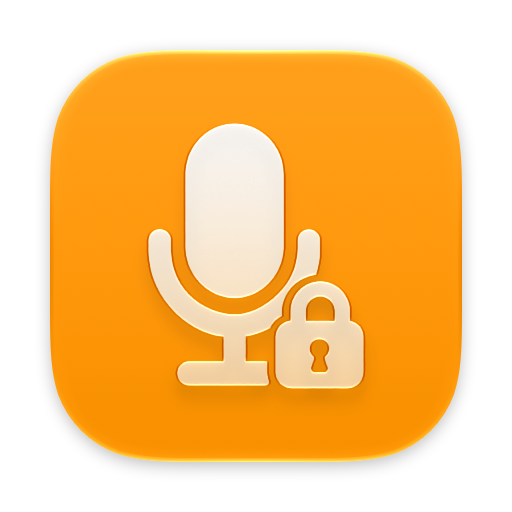
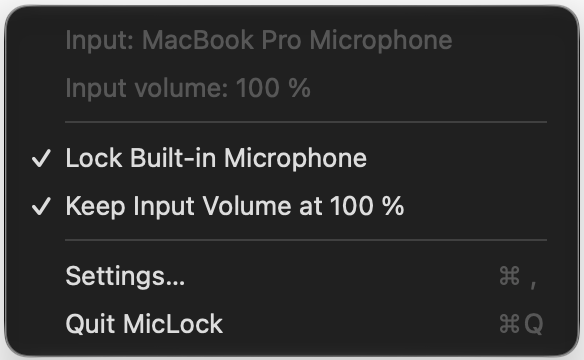
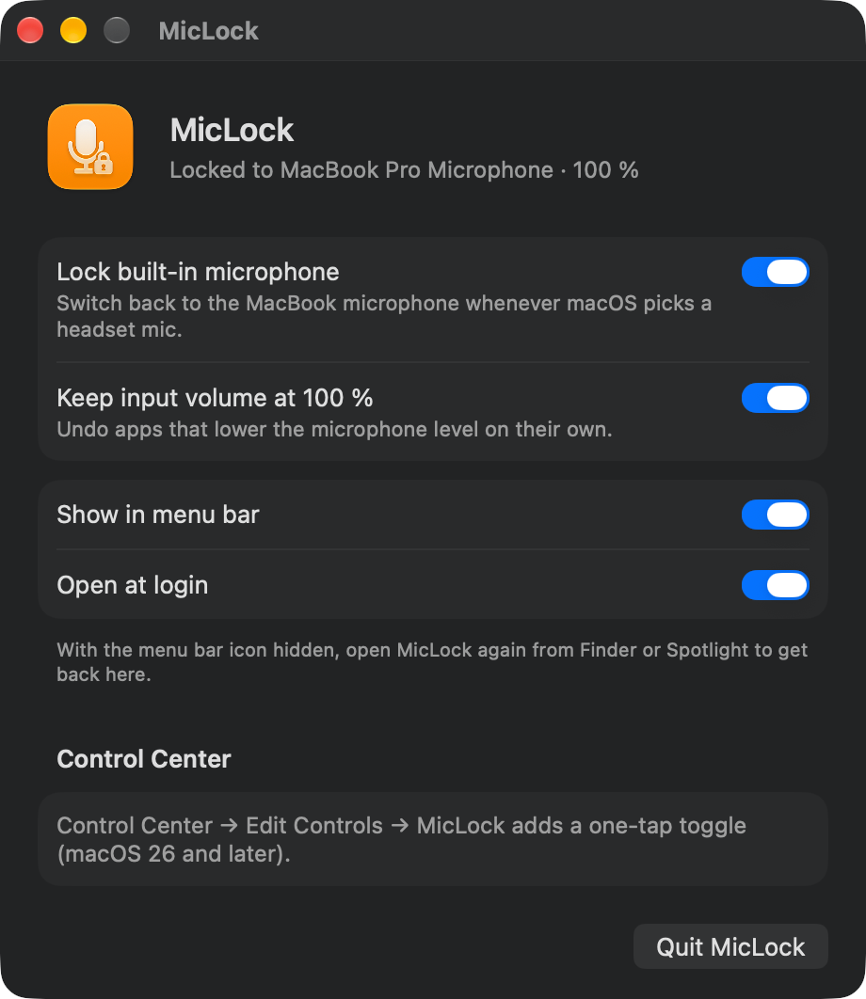
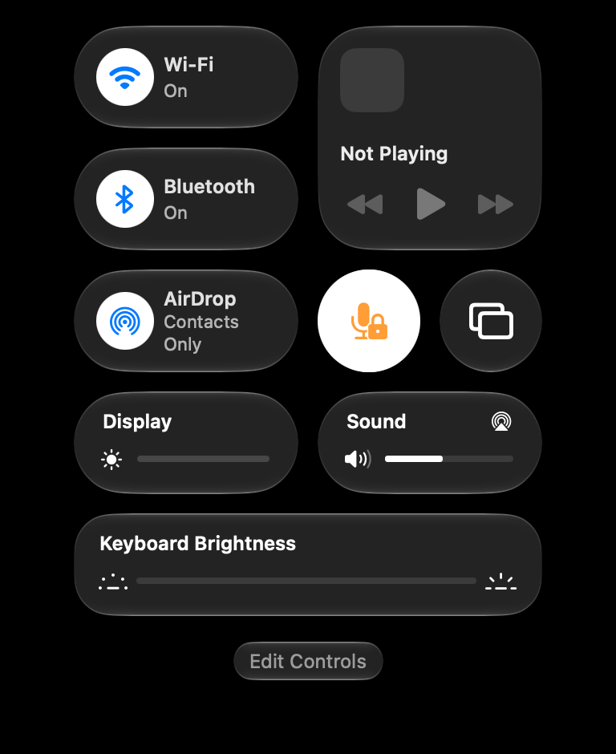

<p align="center">
  
</p>

<h1 align="center">MicLock</h1>

<p align="center">
  Keeps your MacBook's built-in microphone selected and at a fixed volume, whatever headphones you connect.
</p>

<p align="center">
  <a href="https://github.com/AnyByte/mic-lock/releases/latest"></a>
  <a href="https://github.com/AnyByte/mic-lock/actions/workflows/release.yml"></a>
  <a href="https://github.com/AnyByte/mic-lock/releases"></a>
  
  
  
</p>

---

## 🎧 About

macOS switches the input to your headphones' microphone every time you connect them, which drops
Bluetooth headphones to low-quality call audio. MicLock keeps the MacBook's built-in microphone
selected and holds its input volume, which apps and macOS like to lower on their own.

<p align="center">
  
</p>

## ✨ Features

| | |
|---|---|
| 🎙️ **Built-in mic stays selected** | Switches back the moment macOS picks a headset or any other microphone. No polling: MicLock reacts to CoreAudio device events and otherwise sleeps. |
| 🔊 **Fixed input volume** | Holds the level you pick in Settings (100 % by default) and puts it back whenever an app or macOS changes it. Can be turned off separately. |
| 🔁 **Clean off switch** | Turning the lock off hands the input back to the headset it replaced (or the Bluetooth one), just like macOS would have done. |
| 🧭 **Menu bar or hidden** | Lives in the menu bar; hide the icon in Settings and open MicLock again from Finder or Spotlight to get the Settings window back. |
| 🎛️ **Control Center toggle** | A native control (macOS 26+) that shows whether the lock is on and switches it with one tap. It can also go straight into the menu bar. |
| ⌨️ **Scriptable** | `open -g miclock://on`, `miclock://off` and `miclock://toggle` from scripts or Shortcuts. |
| 🪶 **Light** | Native Swift, about 13 MB of memory and no CPU while idle in the background. |

<p align="center">
  
</p>

## 📦 Install

1. Download `MicLock-<version>.zip` from the
   [latest release](https://github.com/AnyByte/mic-lock/releases/latest).
2. Unzip it and move `MicLock.app` to `/Applications`.
3. The app is not notarized, so remove the quarantine flag once before the first launch:

   ```sh
   xattr -dr com.apple.quarantine /Applications/MicLock.app
   ```

4. Open it and turn on **Open at login** in Settings.

## 🎛️ Control Center

On macOS 26 and later MicLock ships a native Control Center toggle:
open Control Center → **Edit Controls** → **MicLock** and drag it into Control Center
or the menu bar. It shows whether the lock is on and switches it with one tap.

The control talks to the running app, so keep MicLock running (turn on **Open at login**).

<p align="center">
  
</p>

## 🛠️ Build from source

Needs Xcode 26 or later: the Control Center toggle is built against the macOS 26 SDK.

```sh
./build.sh      # build.noindex/MicLock.app, universal arm64 + x86_64
./install.sh    # build, copy to ~/Applications, start it and register it as a login item
```

The icon is an Icon Composer file (`icon/AppIcon.icon`); `icon/compile.sh` compiles it
with Xcode 26+ and the output is committed, so builds do not need a new Xcode.

## 🚀 Releases

Pushing a tag `v*` runs the GitHub Actions workflow, which builds the universal app and
attaches the zip to a new release:

```sh
git tag v1.2.3 && git push origin v1.2.3
```
